# Architecture

```mermaid
flowchart LR
  A[CLI / API / pytest fixture] --> B[Validate JSON plan and bounds]
  B --> C[Parent subprocess watchdog]
  C --> D[Fresh Python worker]
  D --> E[Trusted scenario + Probe on stock asyncio]
  E --> F[Real Task.cancel at named points]
  F --> G[Observe invariants and task states]
  G --> H[Bounded cleanup]
  H --> I[Require worker exit]
  I --> J[JSON / inert HTML / Markdown / replay]
```

`config` rejects unknown fields and invalid bounds; `probe` owns explicit instrumentation; `engine` separates observation from cleanup; `_worker` imports trusted targets and runs one loop; `runner` owns the process deadline and bounded campaign; `reports` renders inert local artifacts; `pytest_plugin` provides synchronous/async callables without loop policy changes. `service` is a complete HTTP ASGI demonstration driven by HTTPX.

The parent does not share locks or fixtures with the child. A scenario must construct and instrument its own state. Application tasks are identified by registration and loop-baseline subtraction, never by cancelling all caller-loop tasks. Controller and baseline identities are protected. A fresh process confines a cancellation-resistant scenario, including asyncio shutdown hangs; it does not confine malicious code, subprocess descendants, privileged operations or memory.

The tool deliberately reuses asyncio and pytest rather than implementing UI, event-loop internals, deterministic third-party scheduling, or a full server framework. Delays are stock-loop yields, not real-time guarantees. Multi-cancel and TaskGroup outcomes vary with Python/library versions; reports retain those versions.
